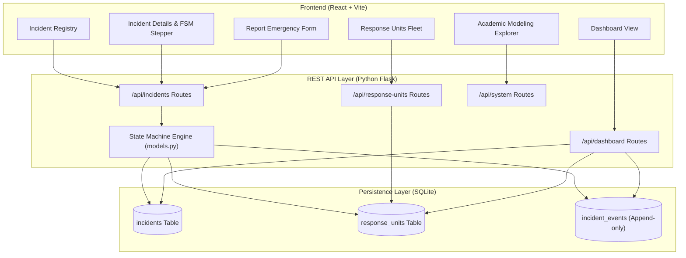
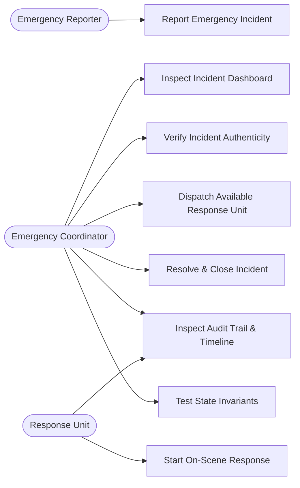
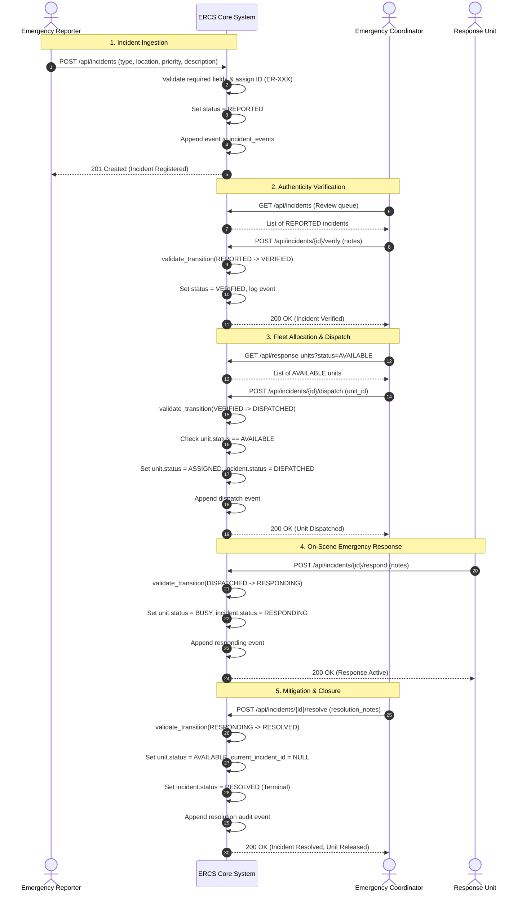
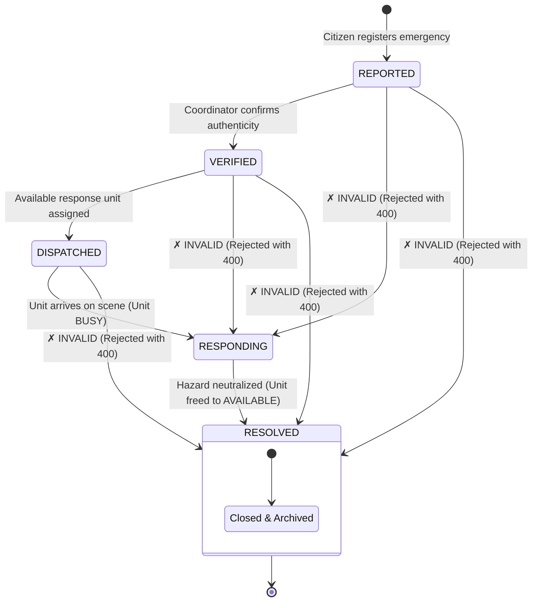
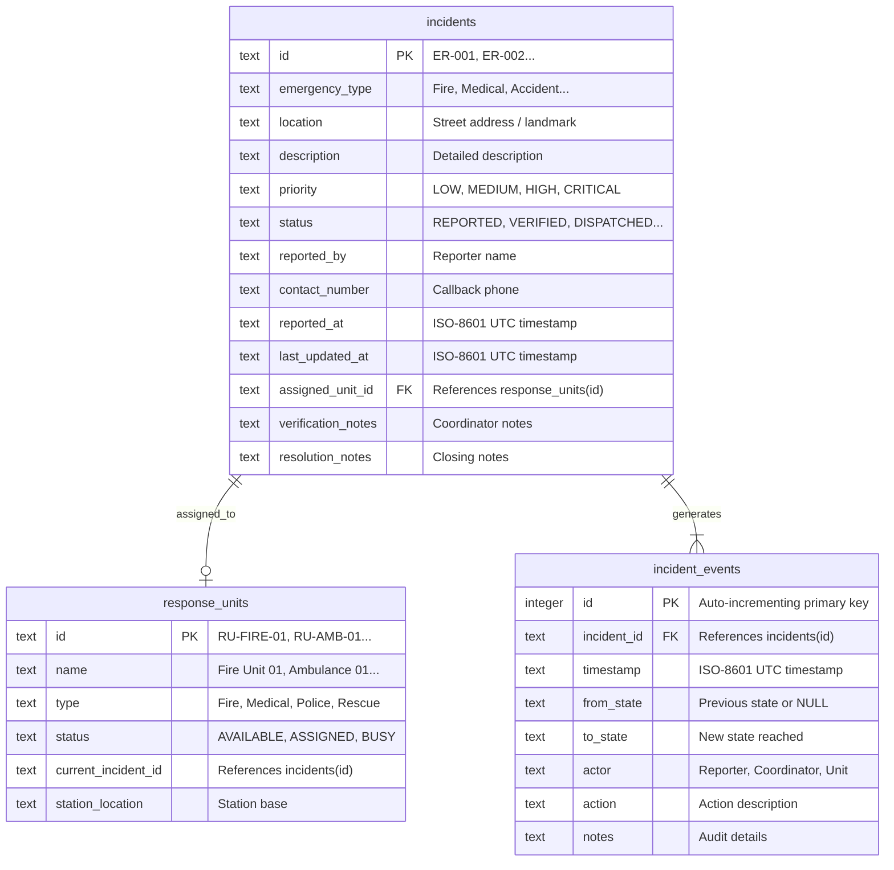
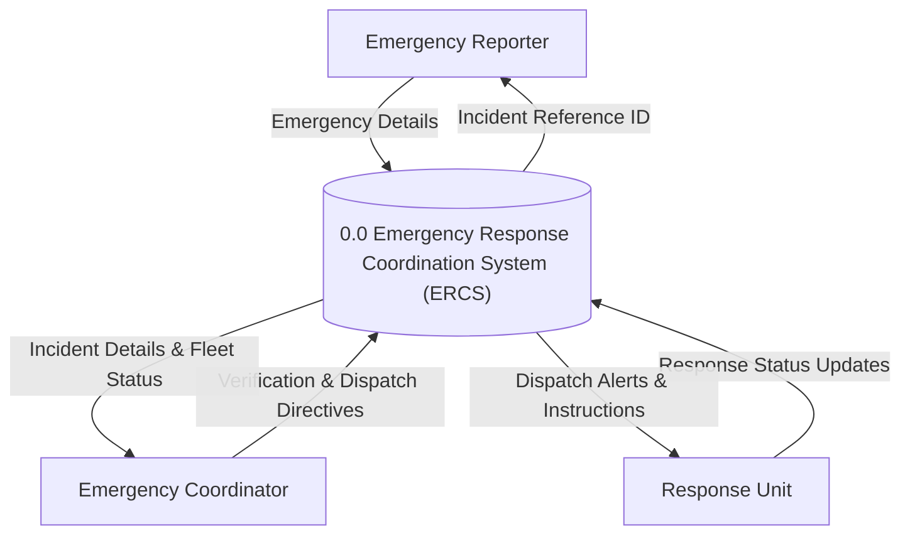
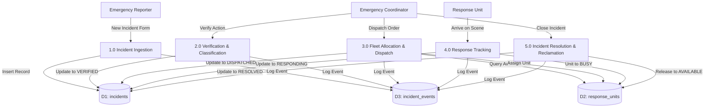

# Detailed Design Specification (DDS)
## Emergency Response Coordination System (ERCS)

**Course:** Software Engineering Practices (SEP)  
**Student Roll No:** 124BTCS1031  
**Project Title:** Sequence and State Modelling of an Emergency Response Coordination System  
**Sustainable Development Goal:** SDG 11 – Sustainable Cities and Communities  

---

## 1. System Architecture

ERCS is designed according to a clean Model-View-Controller (MVC) / Client-Server architectural pattern.

---

## 2. Use Case Model

---

## 3. Sequence Model (Core Interaction Workflow)

This Sequence Diagram documents the exact interactions between all three actors and the ERCS core engine as implemented.

---

## 4. State Model (Finite State Machine)

The incident progresses strictly through five states. Any deviation triggers an immediate rejection.

### 4.1 Response Unit State Machine

```mermaid
stateDiagram-v2
    [*] --> AVAILABLE : Initialized in Fleet

    AVAILABLE --> ASSIGNED : Coordinator dispatches to incident
    ASSIGNED --> BUSY : Unit arrives on scene & starts responding
    BUSY --> AVAILABLE : Incident resolved; unit returns to service
    ASSIGNED --> AVAILABLE : (If reassigned / cancelled)
```

---

## 5. Entity Relationship (ER) Model

---

## 6. Data Flow Diagram (DFD)

### 6.1 Level 0 (Context Diagram)

### 6.2 Level 1 (Decomposition)

