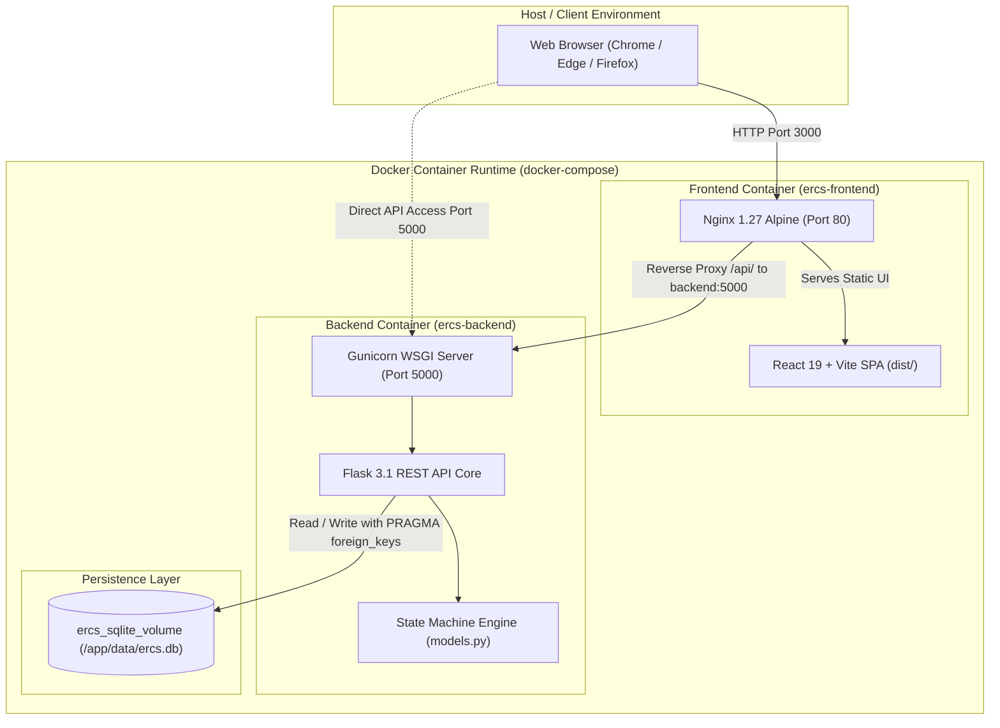
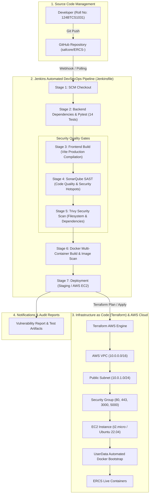

# DevSecOps Architecture & CI/CD Pipeline Specification
## Emergency Response Coordination System (ERCS)

**Academic Course:** DevSecOps Lab — CIAP Microproject  
**Student Roll No:** 124BTCS1031  
**Project:** Sequence and State Modelling of an Emergency Response Coordination System  
**Sustainable Development Goal:** SDG 9 – Industry, Innovation and Infrastructure (Target 9.1 & Target 9.b)  

---

## 1. Multi-Tier Containerized Application Architecture

The containerized ERCS deployment separates presentation, business logic, state machine validation, and persistent storage into isolated components communicating over a secure internal Docker bridge network:



### Architecture Key Principles:
1. **Reverse Proxying & Same-Origin Policy:** The Nginx web server intercepts all `/api/` calls and proxies them internally to `http://backend:5000/api/`. The browser interacts with a unified endpoint, completely eliminating CORS friction and preventing backend container IP exposure.
2. **Persistent Storage Isolation:** The SQLite database is decoupled from the ephemeral container lifecycle by mounting a Docker named volume (`ercs_sqlite_volume`) at `/app/data`. Even when containers are stopped or rebuilt, emergency incident states and event history are preserved.
3. **Least-Privilege Non-Root Execution:** The backend container runs under non-root system user `appuser` (UID `1001`), enforcing Linux kernel-level privilege boundary isolation.

---

## 2. DevSecOps CI/CD Automation Pipeline Workflow

The automated DevSecOps lifecycle integrates security testing, quality gates, automated verification, containerization, and infrastructure-as-code:



---

## 3. Pipeline Stages & Security Gates Deep Dive

| Stage # | Stage Name | Tool / Technology | Objective & Security Function | Quality Gate / Exit Criteria |
|---|---|---|---|---|
| **1** | **SCM Checkout** | Git / GitHub SCM | Clones clean branch commit; records commit SHA and branch metadata. | Successful clone of branch `main`. |
| **2** | **Backend Pytest** | Python `pytest 9.1` | Executes all 14 state transition tests, input validations, and unit availability rules. | 100% test pass rate (`14 passed, 0 failed`). |
| **3** | **Frontend Build** | Node.js 20 / Vite | Installs npm dependencies and compiles optimized static assets (`dist/`). | `npm run build` exits with code 0. |
| **4** | **SonarQube SAST** | SonarScanner | Static analysis for security hotspots, code smells, duplicate blocks, and bugs. | Quality Gate pass / non-blocking review. |
| **5** | **Trivy SCA Scan** | Aqua Trivy | Scans filesystem and manifest files for known CVEs in third-party libraries. | Flag High & Critical CVEs for remediation. |
| **6** | **Docker Build** | Docker BuildKit | Multi-stage container compilation for backend (`python:3.12-slim`) and frontend (`nginx:alpine`). | Clean image build; Trivy image scan. |
| **7** | **AWS IaC Deploy** | HashiCorp Terraform | Automated provisioning of encrypted EC2 instance, VPC, and security group. | `terraform plan` / `docker compose up` verified. |

---

## 4. State Machine Verification in the Pipeline

Because ERCS coordinates life-critical urban emergency incidents, the CI/CD pipeline enforces the **Finite State Machine Invariants** during Stage 2:

```
[ REPORTED ] ──(Verify)──> [ VERIFIED ] ──(Dispatch Unit)──> [ DISPATCHED ] ──(Start Response)──> [ RESPONDING ] ──(Resolve)──> [ RESOLVED ]
```

* **Automated Guard:** Any pull request attempting to bypass the linear sequence (e.g. jumping from `REPORTED` directly to `RESOLVED` or skipping unit dispatch) triggers a test failure in `tests/test_ercs.py`, causing the Jenkins build to fail and preventing deployment.
